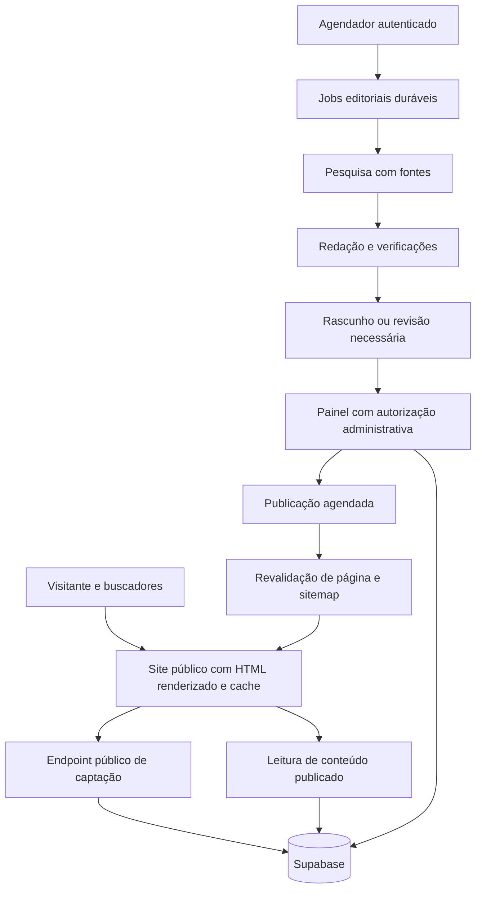

# Lopes Signature — auditoria e plano de evolução

Data: 15/10/2026. Escopo: SEO, blog, automação editorial, desempenho, experiência, conversão, dados e operação.

## Decisão recomendada

Implementar o núcleo editorial no backend TypeScript, conectado à OpenAI Responses API, com pesquisa web, referências persistidas, validação e fila durável no Supabase. Usar um agendador apenas para iniciar/retomar trabalhos. A publicação deve depender de estado editorial explícito e revalidação das páginas.

Não adicionar n8n como dependência obrigatória neste momento. Ele passa a ser uma boa opção de orquestração se a equipe já tiver uma instância mantida e quiser conectar aprovações, notificações e CRM. Em ambas as opções, pesquisa, critérios editoriais, persistência e publicação precisam ser implementados: o orquestrador não resolve qualidade sozinho.

Para o site público, adotar renderização de HTML no servidor/pré-renderização com revalidação. A recomendação é migrar progressivamente as rotas públicas para Next.js, preservando React, Supabase, identidade visual e LPs aprovadas. Começar pelo Journal e páginas comerciais prioritárias. O painel pode continuar isolado na aplicação atual durante a transição.

Esta é uma proposta de arquitetura, não uma migração já executada. Corrigir a origem da publicação vem antes de qualquer deploy.

## Evidência e limites

- Repositório local na branch `update/bauhaus-lp-site-2026-10-06`, commit `d3156ae` de 06/10/2026.
- Endereço público examinado: `https://lopessignature.vercel.app`, encontrado no canonical do projeto. Ainda depende de confirmação de que é o domínio oficial desejado.
- Consultas HTTP públicas, inspeção de código, compilação/checagem de tipos da análise anterior e inspeção em navegador nesta auditoria.
- Home inspecionada em desktop de 1440 × 900; inspeção mobile em 390 × 844 da home, Journal, contato e detalhe Epic. Especialistas consultados no navegador.
- Sem envio de formulários, gravação no banco, publicação de artigos, alteração de credenciais ou deploy nesta auditoria. Nenhum registro de lead foi consultado.
- Não houve acesso ao Search Console, GA4, dados de campo CrUX, configuração Vercel ou políticas reais do banco. Não há nota Lighthouse nem valores medidos de LCP/INP/CLS neste relatório.
- Evidências HTTP em `evidencias-http.json`; inventário e experimentos de compressão em `inventario-imagens.json`.

### Descoberta que condiciona a implementação

A produção difere materialmente desta cópia local. A home publicada possui novos filtros; a API pública retorna 22 imóveis, com campos como `slug`, `published`, `indexable`, `seoTitle`, `seoDescription` e endereço estruturado. O detalhe publicado usa `/imoveis/epic-city-home`, rota ausente no `App.tsx` local, e apresenta uma estrutura comercial mais completa.

Não fazer deploy desta pasta sobre a produção sem localizar e integrar a revisão publicada. Seria possível perder funcionalidades e dados de apresentação já implementados. A evidência prova diferença entre artefatos, mas não identifica qual commit está publicado nem sua origem.

## Diagnóstico confirmado no endereço público

| Evidência | Resultado | Implicação |
| --- | --- | --- |
| `/api/blog` | HTTP 200 com `[]` | Nenhum artigo disponível por essa API; não prova, isoladamente, que a tabela esteja vazia, pois o backend pode ocultar erros |
| `/journal` | Estado vazio no navegador | O problema editorial está visível ao visitante |
| `/sitemap.xml` | HTTP 200, `text/html`, conteúdo do shell da home | Não existe sitemap XML funcional nessa URL |
| URL inexistente de auditoria | HTTP 200 com o mesmo shell | Risco de soft 404; HTTP não distingue conteúdo ausente |
| HTML inicial de home, Journal e detalhe Epic | Mesmo HTML de 2.585 bytes, raiz vazia | Conteúdo principal depende de JavaScript e carregamento da API |
| Canonical inicial dessas páginas | Aponta à home | Sinal de canonicalização inconsistente para páginas internas |
| Journal após renderizar | Título genérico e canonical da home | Falha também no DOM renderizado do Journal |
| Epic após renderizar | Título e canonical próprios | Houve melhoria em produção; persiste dependência de execução do JavaScript |
| JSON-LD | Ausente no HTML inicial consultado e no DOM de home/Epic | Sem estrutura semântica correspondente nessas amostras |
| `/robots.txt` | `Allow: /`, sem referência a sitemap | Não substitui sitemap nem controle de indexação por página |
| WhatsApp da página de contato | Número com DDD 11 e padrão de exemplo | Destino deve ser confirmado/substituído; não testado enviando mensagem |
| Home renderizada | 9 imagens, todas sem `srcset` e sem atributos explícitos width/height | Falta entrega responsiva de imagens; impacto em layout deve ser medido, pois CSS pode reservar espaço |

O Google consegue renderizar JavaScript. O problema não é supor que uma SPA seja invisível: são os sinais inconsistentes de URL, o conteúdo dependente de execução, os estados de erro e a falta de metadados corretos no HTML servido. A orientação oficial recomenda títulos/descriptions específicos e canonical consistente, preferencialmente no HTML. [Google: JavaScript SEO](https://developers.google.com/search/docs/crawling-indexing/javascript/javascript-seo-basics).

## Achados priorizados

### P0 — desbloquear a operação e preservar o que já existe

1. **Divergência entre fonte local e publicada.** Identificar repositório, branch, commit e projeto Vercel corretos; montar preview com a revisão reconciliada. Critério: reproduzir em preview as rotas e o catálogo publicados antes das mudanças.
2. **Captação sem caminho completo nesta implementação.** A função `artifacts/lopes-signature/api/index.ts` aceita somente GET em catálogo/editorial. Os formulários locais usam POST de leads e eventos que ela não oferece. Criar endpoint público mínimo de captação com validação, proteção de abuso e confirmação de gravação durável; manter operações administrativas protegidas. O defeito é confirmado na configuração local; os formulários publicados não foram submetidos.
3. **Persistência de leads incompatível com o SQL fornecido.** `leads.ts` gera `lead-<timestamp>`, enquanto `supabase_schema.sql` declara UUID. O retorno `error` da inserção é ignorado e a resposta pode indicar sucesso apenas com memória. Corrigir UUID, checagem de erro, idempotência e contrato de resposta. Critério: um envio controlado em staging continuar disponível após reiniciar o processo.
4. **Autorização administrativa incompleta no servidor completo.** Não há verificação de sessão/papel nas rotas de gravação, CRM e leitura de leads. Os SQLs permitem acesso amplo com `FOR ALL USING (true)` e criam administradores automaticamente. Auditar políticas efetivas antes de substituir as existentes; proteger cada endpoint e remover promoção automática indevida. Esses são achados de código/SQL local, não uma afirmação de que todas essas rotas estejam expostas em produção.

### P1 — indexação, blog e confiança comercial

5. **SEO de rota insuficiente.** Entregar título, description, canonical absoluto, Open Graph, H1 e conteúdo principal específicos no HTML da URL. Corrigir Journal, categorias e institucionais; preservar avanços do detalhe publicado. `/admin`, previews e rascunhos recebem noindex e acesso protegido quando necessário.
6. **Sitemap e códigos HTTP incorretos.** Gerar sitemap XML de páginas publicadas e indexáveis. URLs inexistentes retornam 404 real; conteúdo indisponível por falha temporária não deve virar catálogo vazio nem falso 404. Criar redirecionamentos 301 para URLs antigas com correspondência real. Não redirecionar indiscriminadamente tudo para a home.
7. **Blog sem operação editorial confiável.** Diferenciar vazio de erro; listar apenas artigos publicados; consultar artigo por slug; implementar edição, preview, agendamento, autor/revisor, data de publicação/atualização e fontes. A publicação só termina após persistência e revalidação; erros ficam visíveis no painel.
8. **Geração atual sem pesquisa verificável.** `blog.ts` pede artigos ao OpenRouter com base em tópicos; não pesquisa fontes, não registra evidências e publica diretamente. Substituir por pipeline com pesquisa, checagem factual, controle de repetição e estados. Não tratar texto fluente como evidência de qualidade.
9. **Automação desconectada.** A rota de cron está no servidor completo, fora da função pública, e as configurações Vercel estão em raízes diferentes. A consulta pública do caminho de cron retornou 404. Configurar agendador na implantação correta, autenticar disparos e usar jobs recuperáveis; não executar todo o trabalho em uma única requisição longa.
10. **Categorias locais não são filtros reais.** `catalog-page.tsx` inicializa `search` com a categoria; a API pesquisa título/localização/construtora, e o mapeamento local fixa “Apartamentos”, destaque e disponibilidade. Preservar a taxonomia mais completa da produção, formalizar filtros e paginar no banco. Não aplicar a correção ao modelo antigo sem reconciliar a versão.
11. **Dados comerciais demonstrativos.** LP genérica e Raio-X preenchem falhas com preço, configuração ou imagens genéricas. Ausência de dados deve virar campo omitido, estado indisponível ou contato, conforme o caso. Não anunciar configuração, disponibilidade, autoria ou valorização sem fonte apropriada.
12. **Especialistas e canais incorretos.** A fonte atual é uma lista estática de 16 pessoas. Migrar para cadastro editável e validado; corrigir fotos, nomes, unidades, CRECI quando aplicável, especialidades, contato e ordem de apresentação com os dados fornecidos. Não inferir nome/função pela fotografia ou nome do arquivo.

### P2 — velocidade, experiência e manutenção

13. **JavaScript público inclui o painel.** `App.tsx` importa todas as páginas diretamente. O build local produziu bundle principal de aproximadamente 714 KB, 206 KB gzip, e CSS de 157 KB, 27 KB gzip. Separar painel, carregar recursos de galeria/gráficos sob demanda e usar renderização de servidor nas rotas públicas. Esses números são do build local, não medição da produção.
14. **Imagens pesadas e sem variantes.** Há originais locais de retratos de 9,0 MB e 7,8 MB. Gerar tamanhos por uso, preservar transparência, fornecer `srcset`/`sizes` ou otimizador equivalente, reservar proporção e carregar galerias fora da primeira tela sob demanda. Otimizar também o acervo remoto do Supabase; os 76 MB locais não representam todo o catálogo publicado.
15. **Fontes e vídeo precisam de orçamento de carregamento.** HTML e CSS solicitam famílias/pesos sobrepostos. Auditar uso, servir apenas os necessários, com WOFF2 e estratégia de exibição. Manter poster rápido e prioridade da imagem principal; vídeo não deve competir com recursos essenciais nem ser necessário para compreender a página.
16. **Acessibilidade inconsistente nos componentes locais.** Raio-X customizado não implementa semântica de diálogo, foco preso/restaurado e fechamento por Escape. Há formulários que dependem de placeholder. Usar primitives de diálogo já disponíveis, labels persistentes, erros associados e avisos acessíveis. Menu mobile deve expor estado aberto e devolver foco corretamente.
17. **Manutenção e falhas silenciosas.** `admin.tsx` concentra cerca de 1.140 linhas; modelos duplicados, `any`, contrato OpenAPI incompleto e várias chamadas sem checar resultado. Separar módulos por domínio e padronizar validação, mapeamento de campos, erros, logs sem dados pessoais e testes de contrato.
18. **Conversão e mensuração incompletas.** Configurações locais de tracking vivem em memória e não há aplicação desses IDs no site encontrada no código. Persistir configurações, definir eventos de visita/contato/lead com deduplicação, respeitar escolhas de consentimento pertinentes e medir lead confirmado, não simples clique no botão.

## Experiência visual e responsividade

A identidade atual pode ser preservada: cores claras, detalhes dourados, tipografia editorial, fotografia e páginas próprias dos empreendimentos. Não há evidência de que um redesenho integral seja necessário para corrigir os bloqueios.

Na amostra mobile de 390 px, home, Journal, contato e Epic não apresentaram overflow horizontal na checagem do documento. Isso não certifica todos os componentes, ampliação de texto ou aparelhos. O Epic publicado tem hierarquia comercial clara, galeria, plantas e contato; o Journal tem estado vazio legível, mas não oferece conteúdo.

Melhorias propostas:

- Colocar descoberta do catálogo e contato em posição fácil de alcançar, com filtros verdadeiros e preservação da busca ao voltar.
- Diferenciar erro de conexão, ausência de resultado e ausência de cadastro.
- Validar em 360, 390, 768, 1024 e 1440 px; testar zoom/texto ampliado, orientação horizontal, teclado e modais.
- Rever texto utilitário de 9–11 px, contrastes reais e controles pequenos. Não concluir conformidade WCAG apenas a partir de classes CSS.
- No artigo: largura de leitura confortável, hierarquia H1/H2/H3, sumário quando útil, fontes próximas das afirmações, autoria/revisão real e CTA relacionado ao assunto.
- Corrigir destinos sociais, privacidade/termos, número de WhatsApp e promessas operacionais como prazo de resposta, mediante dados confirmados.

### Avaliação técnica heurística da cópia local

| Dimensão | Nota provisória (0–4) | Base |
| --- | --- | --- |
| Acessibilidade | 2 | Existem labels e foco em algumas superfícies; diálogos e formulários têm lacunas verificadas no código |
| Desempenho | 1 | Bundle concentrado e originais muito maiores que os usos |
| Responsividade | 2 | Breakpoints implementados; produção passou na amostra estreita, sem verificação completa da cópia local |
| Tema e consistência | 2 | Tokens presentes, com estilos claros/escuros e cores repetidas fora dos tokens |
| Integridade de implementação | 1 | Fallbacks comerciais e operações sem confirmação durável |
| Total | 8/20 | Indicador heurístico, não Lighthouse, laudo WCAG ou avaliação completa da produção |

O detector Impeccable sinalizou escolha de fonte e muitas divergências de escala tipográfica. A fonte é uma decisão explícita do projeto e deve ser preservada; esse alerta não é defeito de SEO. Os avisos tipográficos não são 141 problemas comprovados: exigem triagem contextual. Corrigir primeiro os defeitos funcionais e de legibilidade, não trocar a identidade por causa de um detector.

## Arquitetura proposta

### Escolha de renderização

| Opção | Vantagem | Custo/limitação | Decisão |
| --- | --- | --- | --- |
| SPA atual com metatags no cliente | Pouca alteração imediata | Não resolve sozinha HTML vazio, status HTTP e consistência editorial | Contenção temporária |
| Pré-render estático no Vite atual | Pode acelerar páginas de conteúdo estável | Exige pipeline de atualização e tratamento próprio de conteúdo dinâmico, status e rotas | Alternativa se migração estiver impedida |
| Next.js para site público | React reaproveitável, metadados de servidor, sitemap e cache integrados | Migração inicial e disciplina de cache/revalidação | Recomendado progressivamente |
| Astro para conteúdo público | Boa entrega de HTML e pouca hidratação por padrão | Outra estrutura para integrar catálogo, painel e componentes existentes | Viável, mas menos alinhado ao reaproveitamento pretendido |

A escolha de Next.js é uma decisão de engenharia para este projeto, não um fator de ranking. O benefício esperado vem do HTML correto e rápido, das URLs e da experiência. As APIs oficiais oferecem metadados de servidor e sitemap dinâmico. [Next.js: metadata](https://nextjs.org/docs/app/getting-started/metadata-and-og-images), [sitemap](https://nextjs.org/docs/app/api-reference/file-conventions/metadata/sitemap).

### Regras de migração

- Inventariar URLs publicadas e seus destinos antes de qualquer mudança; manter `/journal` como endereço editorial inicialmente, sem renomear para `/blog` por suposição de ganho.
- Preservar páginas `/imoveis/:slug` já existentes em produção, LPs especiais e referências recebidas de campanhas.
- Home e institucionais: HTML pré-renderizado; catálogo e detalhes: renderização/cache com política explícita de atualização; Journal/artigos: HTML publicado e revalidação no evento de publicação.
- Dados de preço/disponibilidade precisam de atualização própria; não reutilizar cache editorial longo indiscriminadamente.
- Rascunhos, previews, autenticação, leads e painel nunca entram em cache público compartilhado.
- API de listagem com campos resumidos e paginação; corpo completo do artigo e galerias extensas apenas no detalhe.
- Uma única origem de verdade para domínio oficial, especialistas, imóveis e estados editoriais.

## Agente interno versus n8n

| Critério | Backend interno | n8n |
| --- | --- | --- |
| Custo operacional | Reaproveita código/banco; pode haver custo adicional de worker/fila/hospedagem | Cloud ou infraestrutura própria, além do provedor de IA quando usadas credenciais próprias |
| Qualidade do texto | Depende de pesquisa, instruções, dados locais e avaliação | Depende dos mesmos elementos; o editor visual não aumenta a precisão por si só |
| Manutenção | Testes, revisão e versionamento no repositório | Fluxo visual acessível; operação e versionamento variam por edição/plano |
| Automatização | Jobs, agenda e revalidação sob medida | Conectores e orquestração rápidos |
| Integração ao painel | Direta | Exige contrato estável com o backend |
| Adequação atual | Maior, pois o projeto já é TypeScript/Supabase | Maior se já existir operação n8n mantida pela equipe |

O n8n Cloud Starter consultado anuncia €20/mês com cobrança anual. A Community Edition auto-hospedada é gratuita como edição, mas requer hospedagem, atualização e backups; alguns recursos de colaboração e governança não estão incluídos. Esses valores e recursos são referência de 15/10/2026, não contratação nem orçamento fechado. [n8n: preços](https://n8n.io/pricing/), [edições](https://docs.n8n.io/hosting/community-edition-features/).

Recomendação final: serviço interno com interface de jobs que também possa receber disparos do n8n no futuro. Evitar manter duas implementações de geração editorial.

## Como produzir conteúdo útil e verificável

### Fluxo editorial

1. **Planejamento:** levantar dúvidas reais dos compradores, consultas do Search Console quando disponível e lacunas do acervo. Agrupar por intenção; impedir múltiplas páginas disputando a mesma pergunta sem propósito distinto.
2. **Pesquisa:** usar busca web com fontes abertas, priorizando documentos originais. Candidatos: IBGE, Banco Central, Prefeitura de Goiânia, legislação oficial e relatórios de mercado identificados por metodologia e período. Para projetos, usar materiais oficiais e dados comerciais confirmados. A disponibilidade de cada dado precisa ser verificada a cada pauta.
3. **Registro das evidências:** salvar URL, título, responsável, data de publicação quando disponível, data de consulta, recorte geográfico, período de referência e fatos usados. URL citada precisa corresponder ao conteúdo efetivamente consultado.
4. **Redação:** construir argumento local e útil, com H1, seções coerentes, slug, resumo, description, imagem legítima, links internos e CTA pertinente. Não perseguir densidade artificial de palavra-chave nem contagem fixa de palavras.
5. **Verificação:** conferir números, datas, geografias e conclusão contra evidências. Se só houver dado municipal, não apresentá-lo como medição do Bueno ou Marista. Separar preço anunciado de transacionado, variação nominal de real e correlação de causalidade. Pesquisa não substitui verificação.
6. **Revisão:** checar contradições, repetição, atribuições, links, schema e conteúdo comercial. Encaminhar dúvidas a revisão humana; uma segunda chamada de IA não certifica a verdade.
7. **Publicação:** gravar, registrar revisão/autor real, agendar, revalidar HTML/sitemap e verificar URL pública. Falha de banco ou revalidação mantém trabalho recuperável.
8. **Manutenção:** reavaliar conteúdo sensível à data; atualizar texto e data de modificação somente quando houver alteração substancial.

Pesquisa pela Responses API pode retornar referências estruturadas e fontes clicáveis, que devem aparecer de forma acessível no produto. Não é necessário introduzir um framework complexo de agentes para esse pipeline. [OpenAI: web search](https://developers.openai.com/api/docs/guides/tools-web-search).

### Estados e dados mínimos

- Artigo: `id`, slug único, título, resumo, conteúdo estruturado ou Markdown sanitizado, categoria, intenção, SEO, imagem/alt, fontes, autor, revisor, status, datas e revisão.
- Estados do artigo: `draft`, `needs_review`, `approved`, `scheduled`, `published`, `archived`.
- Job: estágio, chave idempotente, pauta, tentativas, próximo retry, lease/lock com expiração, IDs de resposta do provedor, erro, tokens e custo estimado/real quando disponível.
- Estados do job: `queued`, `researching`, `writing`, `checking`, `completed`, `failed`.
- Publicação exige conteúdo aprovado; artigo sem suporte para afirmações essenciais permanece em revisão.
- Um único consumidor assume cada job; timeout não pode produzir dois artigos. Retry limitado e persistido; orçamento esgotado interrompe novas gerações e sinaliza no painel.
- Chaves somente no servidor; não salvar OpenAI/OpenRouter em localStorage. Não enviar leads ou dados pessoais ao agente editorial.
- Conteúdo pesquisado é dado, não instrução. Referências e saídas passam por validação antes de renderizar; se houver download próprio, bloquear URLs internas e esquemas inseguros.

### Política de automação recomendada

Automatizar pesquisa, redação, validações e agenda. Começar com aprovação editorial dos artigos do piloto. Depois habilitar publicação automática apenas para classes de pauta com critérios verificáveis e amostras revisadas, mantendo revisão para dados novos de mercado, afirmações de investimento, legislação, preço e disponibilidade.

A revisão proposta é um controle de qualidade do produto, não uma autorização adicional exigida para esta auditoria. Deve ser configurável no painel, com histórico, pausa e reversão de publicação.

Começar com 2–3 artigos originais por semana, como hipótese operacional a ajustar pela qualidade e capacidade de revisão. Não existe frequência que garanta ranking. A orientação do Google exige valor, precisão e revisão; produção em escala sem valor pode infringir suas políticas. [Google: conteúdo com IA](https://developers.google.com/search/docs/fundamentals/using-gen-ai-content).

### Pautas iniciais, sujeitas à pesquisa

- Bueno e Marista: diferenças práticas de localização, rotina e oferta, com limites dos dados disponíveis.
- Como comparar plantas de apartamentos de alto padrão além da metragem.
- Apartamento pronto ou em construção: critérios de comparação e perguntas ao vendedor.
- O que um índice de preço anunciado mostra — e o que ele não comprova sobre valorização de uma unidade.
- Custos de aquisição e manutenção: quais informações levantar antes de comparar imóveis, com regras verificadas na data.
- Arquitetura e vida no entorno do Vaca Brava, com referências e imagens autorizadas.
- Guias de empreendimentos com informações oficiais, sem repetir a ficha comercial em vários artigos.

Não são palavras-chave com volume comprovado. O mapa final deve incorporar dados de busca e objetivos comerciais reais.

### Custo e escolha do modelo

Manter o modelo configurável. Para o piloto, comparar um modelo econômico para triagem/checagens estruturais com um modelo de melhor redação para pesquisa e versão final, usando dez pautas representativas e a mesma rubrica: cobertura factual, qualidade das fontes, utilidade local, originalidade editorial, erros e custo total. O modelo final depende desse teste e do acesso da conta; não foi executada chamada paga nesta auditoria.

O cálculo deve incluir tokens cobrados de todas as etapas, pesquisa, revisões, retries e infraestrutura. Referência oficial consultada: web search custa US$10 por 1.000 chamadas, mais tokens de conteúdo recuperado/modelo. Exemplo meramente aritmético, com preços Standard de contexto curto de `gpt-6.1-sol`: 25 mil tokens de entrada a US$2/milhão + 10 mil de saída a US$10/milhão + 5 buscas a US$0,01 = US$0,20 por execução; 12 execuções iguais = US$2,40. Isso não é orçamento observado: contexto real, raciocínio cobrado, repetição e quantidade de buscas podem aumentar o custo. Infraestrutura, mídia, câmbio, impostos e trabalho editorial não estão incluídos. [OpenAI: preços](https://developers.openai.com/api/docs/pricing).

Definir limite mensal e por job, alertas, número máximo de buscas/tentativas e relatório de custo por artigo aprovado. Para esse volume, o custo de revisão e manutenção pode superar o de tokens; o piloto medirá ambos.

## SEO técnico e estrutura de conteúdo

- Definir domínio oficial e redirecionar aliases somente após confirmar propriedade e configuração.
- Canonical próprio para cada página indexável; tratar filtros/paginação segundo seu conteúdo, sem canonicalizar todas as categorias à home.
- Sitemap com URLs publicadas, canônicas e indexáveis; `lastmod` fiel a alterações reais. Rascunhos, páginas vazias sem valor e filtros combinatórios não entram automaticamente.
- Dados estruturados compatíveis com conteúdo visível: organização/imobiliária e unidades verificadas, BreadcrumbList, BlogPosting e autor real. Schema válido não garante rich result; não prometer resultado especial para toda ficha de imóvel ou FAQ.
- Páginas de bairros com conteúdo próprio e demanda real, sem dezenas de variações vazias de cidade/bairro.
- Links contextuais entre guias, bairros e imóveis relacionados; breadcrumbs e navegação consistentes.
- Uma política para imóveis retirados: manter página útil e histórico quando apropriado; 404/410 para remoção definitiva, ou 301 apenas para substituto equivalente.
- Metadados e imagem social próprios por artigo/imóvel; substituir imagem genérica por material autorizado, sem inventar fotografias de empreendimentos.
- Search Console: propriedade verificada, sitemap enviado, inspeção de URLs representativas e acompanhamento de cobertura, canonical escolhido, cliques, impressões e conversão. Nenhuma posição atual foi aferida nesta auditoria.

## Imagens: plano e experimento

O inventário local contém 261 imagens, totalizando 78.968.716 bytes (aproximadamente 75,3 MiB), incluindo a sequência de hero não versionada. O total não equivale a bytes baixados na primeira visita. Parte do catálogo publicado usa Storage remoto e precisa de inventário próprio.

| Amostra local | Original | WebP experimental | Redução |
| --- | ---: | ---: | ---: |
| Retrato Leandro Bender | 1.362.482 B | 73.626 B | 94,6% |
| Retrato Anna Paula | 1.240.238 B | 62.342 B | 95,0% |
| Banner hero 2 | 2.198.641 B | 84.064 B | 96,2% |
| Poster do vídeo | 218.713 B | 127.426 B | 41,7% |
| Logo | 10.545 B | 8.644 B | 18,0% |

Método: Pillow, WebP quality 85/method 6; retratos limitados a 960 × 1200, demais imagens a 1920 × 1080, mantendo proporção. Resultados obtidos em memória; nenhum original foi sobrescrito. A redução combina compressão e, quando aplicável, redimensionamento. Não houve aprovação visual dessas versões; não se afirma ausência de perda perceptível.

Implementação proposta:

- Guardar originais fora da entrega pública cotidiana e manter registro de origem/direitos. Preservar sidecars e metadados de proveniência das imagens Bauhaus no processo de derivação.
- Retratos: variantes de 320/640/960 px conforme o enquadramento, sem cortar indevidamente rosto/corpo, preservando alpha quando necessário. Aplicar a política às fotos corretas fornecidas pelo usuário.
- Imóveis: variantes de card e detalhe, por exemplo 480/768/1280/1920 px; nunca ampliar imagens menores. Escolher dimensões pelos componentes reais e densidade de tela.
- Testar AVIF versus WebP em amostras: AVIF quando trouxer economia sem artefatos; WebP como alternativa. Não converter tudo indiscriminadamente. Logo pequeno pode permanecer como está; SVG somente se houver original vetorial legítimo.
- Plantas: legibilidade de cotas e texto tem prioridade sobre taxa de compressão. Disponibilizar versão ampliada; testar lossless ou compressão menos agressiva.
- Usar nomes estáveis/versionados, cache longo para arquivos imutáveis e manifest de variantes. Atualizar referências sem quebrar URLs existentes do Storage.
- Não carregar a sequência de 25 MB na hero atual sem necessidade. Verificar uso antes de excluí-la da publicação.
- Validar aparência desktop/mobile e carregamento com conexão limitada antes da troca final.

## Especialistas e atualização visual

Receber por profissional: nome público completo, unidade, cargo/especialidade, CRECI quando aplicável, telefone/WhatsApp profissional em formato internacional, e-mail público se desejado, biografia aprovada, foto correta, ordem e estado ativo/inativo. Confirmar também o número central e as redes sociais oficiais.

Criar cadastro `specialists` no Supabase com unidade estruturada, campos opcionais, descrição da foto e ordenação; acesso de escrita restrito. Não preencher telefone ou credenciais ausentes com exemplos. Ligar a ação de contato ao profissional selecionado e carregar esse contexto no formulário.

A atualização de retratos, descrições e imagens comerciais depende do material correto que o usuário fornecer. A preparação de estrutura e otimização pode avançar sem inventar identidades.

## Sequência de execução e critérios de aceite

| Etapa | Entrega | Aceite |
| --- | --- | --- |
| 0. Fonte de publicação | Revisão atual reconciliada, preview e inventário de URLs | Preview reproduz catálogo, detalhes e LPs existentes |
| 1. Operação | Leads duráveis, autorização, erros visíveis e canais corretos | Teste em staging de envio, reinício, leitura autorizada e rejeição de acesso indevido |
| 2. SEO estrutural | HTML das rotas públicas, canonical, metadados, sitemap e status | Artigo/imóvel legíveis sem JS; URL ausente 404; sitemap XML só com páginas elegíveis |
| 3. Blog | Cadastro editorial, estados, fontes, slug, preview e agenda | Rascunho privado; publicação visível na URL e sitemap; falha não informa sucesso |
| 4. IA | Pesquisa e redação com evidências, jobs e orçamento | Dez pautas avaliadas; sem números essenciais sem fonte; retry não duplica artigo |
| 5. Desempenho e UX | Imagens responsivas, bundles separados, foco/modais e fontes | Comparação visual aprovada; testes mobile/teclado; métricas de laboratório registradas |
| 6. Dados oficiais | Especialistas, imagens e textos aprovados | Correspondência entre cadastro fornecido, painel, API e site |
| 7. Publicação e medição | Deploy gradual, reversão e Search Console | Checklist de URLs, captação e metadados em produção; acompanhamento de erros e indexação |

Não atrelar hotfix de sitemap/canonical e captação a uma reescrita completa. Após reconciliar a revisão, aplicar contenção onde segura e migrar por rota. Não executar SQL destrutivo em produção sem inspecionar schema, políticas, backups e dependências atuais.

### Metas de desempenho

Metas de Core Web Vitals: LCP ≤ 2,5 s, INP ≤ 200 ms e CLS ≤ 0,1 no percentil 75, por classe de dispositivo, quando houver amostra de campo suficiente. Usar laboratório como diagnóstico, não prova de experiência real. Essas são metas, não resultados medidos. [web.dev: Web Vitals](https://web.dev/articles/vitals).

Comparar páginas equivalentes com configuração de teste repetível: home, catálogo, detalhe, Journal, artigo e contato. Registrar bytes transferidos, imagem principal, JavaScript inicial, falhas de rede e estabilidade; estabelecer orçamento por tipo de página após a linha de base da revisão correta.

### Testes necessários

- Autorização e isolamento de rascunhos/leads; captura e persistência após reinício.
- Mapeamento de campos de imóvel e filtros por categoria/localização com dados representativos.
- HTML e metadados de artigo, imóvel, categoria, inexistente e preview.
- Sitemap válido, redirects e links internos sem quebra.
- Pipeline editorial com respostas gravadas de teste, sem custo externo no CI; piloto pago separado, com limite explícito.
- Jobs concorrentes, timeout, reexecução e publicação idempotente.
- Imagens, formulários, navegação e diálogos em mobile/desktop e teclado.
- Validação de builds e tipos, que já passaram na base local, mas não substituem os testes funcionais acima.

## Informações externas ainda necessárias

1. Domínio oficial e identificação do projeto/revisão efetivamente publicado.
2. Existência de n8n já operado pela equipe.
3. Dados e retratos corretos dos especialistas; canais oficiais e textos comerciais aprovados.
4. Acesso administrativo apropriado a Vercel/Supabase para verificar configuração e políticas efetivas; não colar chaves no chat nem colocá-las no frontend.
5. Search Console/GA4 para medir situação orgânica e conversões reais.
6. Credencial OpenAI configurada no servidor, limite de gasto e responsável editorial para o piloto, na etapa de implementação.

Essas dependências não impedem a auditoria e especificação entregues aqui. Impedem afirmar que a produção já foi corrigida ou publicar dados que ainda não foram fornecidos.

## Encaminhamento de UI

Aplicar correções funcionais e SEO em primeiro lugar. Para a interface: `impeccable harden` em erros/diálogos/formulários; `impeccable optimize` em imagens e carregamento; `impeccable adapt` na matriz de tamanhos; finalizar com `impeccable polish` após testes. Os comandos são auxiliares de implementação, não substituem critérios de aceite.

## Resultado desta entrega

Auditoria e proposta técnica concluídas; evidências públicas e experimento de compressão registrados. Nenhuma alteração funcional, substituição de especialista, conversão de acervo publicada, agente pago ativado ou deploy realizado. O próximo trabalho deve começar pela revisão publicada correta, para que as melhorias sejam aplicadas sem regressão.
